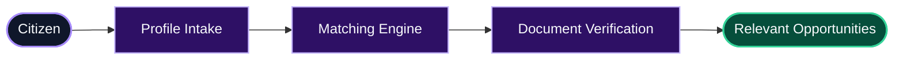
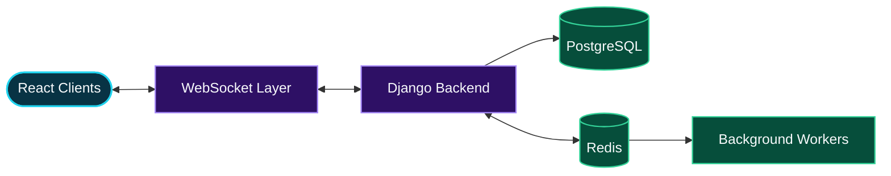
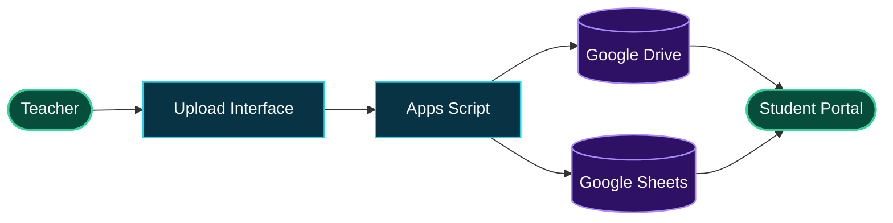
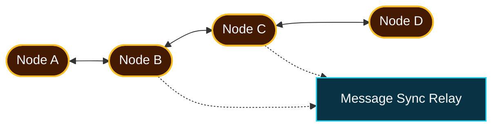
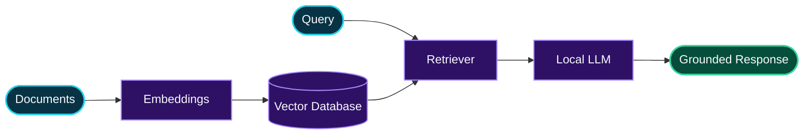

<p align="center">

</p>

<h1 align="center">ENGINEERING AT THE EDGE OF WHAT'S NEXT.</h1>

<p align="center">
<strong>Intelligent systems · Autonomous software · Resilient infrastructure</strong><br />
<sub>Exploring emerging technologies, unconventional computing, and practical engineering.</sub>
</p>

<p align="center">


</p>

## ◈ 01 · SYSTEMS IN THE LAB

<table>
<tr>
<td width="50%" valign="top">
<h3><code>01</code> &nbsp;Applied Intelligence</h3>
<p><sub>Agentic orchestration, grounded retrieval, and local model inference.</sub></p>
<p>


</p>
</td>
<td width="50%" valign="top">
<h3><code>02</code> &nbsp;Distributed Computing</h3>
<p><sub>Offline-first coordination, peer-to-peer relays, and edge resilience.</sub></p>
<p>


</p>
</td>
</tr>
<tr>
<td width="50%" valign="top">
<h3><code>03</code> &nbsp;Infrastructure</h3>
<p><sub>Linux-first services, real-time messaging, and containerized deployments.</sub></p>
<p>


</p>
</td>
<td width="50%" valign="top">
<h3><code>04</code> &nbsp;Security &amp; Experimental Computing</h3>
<p><sub>Zero-trust defaults, defensive engineering, and constrained-device runtimes.</sub></p>
<p>


</p>
</td>
</tr>
</table>

## ◈ 02 · ENGINEERING PROJECTS

<sub>Interactive architecture blueprints — expand any system below to inspect its dataflow.</sub>

<br />

<details open>
<summary><strong><code>01</code> &nbsp;PAANGBA — AI-Assisted Financial Access &amp; Lender Matching</strong></summary>

<br />

> `APPLIED AI` · `DOCUMENT INTELLIGENCE` · `RECOMMENDATION SYSTEMS`



</details>

<details>
<summary><strong><code>02</code> &nbsp;HOUSEY — Real-Time Multiplayer Gaming Platform</strong></summary>

<br />

> `DJANGO` · `WEBSOCKETS` · `REDIS` · `POSTGRESQL`



</details>

<details>
<summary><strong><code>03</code> &nbsp;COACHING WEBSITE — Serverless Content Management</strong></summary>

<br />

> `REACT` · `GOOGLE DRIVE` · `GOOGLE SHEETS` · `APPS SCRIPT`



</details>

<details>
<summary><strong><code>04</code> &nbsp;OFFLINE MESH — Disaster Relief Communication</strong></summary>

<br />

> `DISTRIBUTED NETWORKING` · `OFFLINE-FIRST` · `STORE-AND-FORWARD`



</details>

<details>
<summary><strong><code>05</code> &nbsp;ESIRE — Scheme Intelligence &amp; Eligibility Engine</strong></summary>

<br />

> `AI` · `SCHEME DISCOVERY` · `CONSTRAINT REASONING`


</details>

<details>
<summary><strong><code>06</code> &nbsp;LLM &amp; RAG — Applied Intelligence Exploration</strong></summary>

<br />

> `LOCAL INFERENCE` · `VECTOR DATABASES` · `RETRIEVAL`



</details>

## ◈ 03 · EMERGING TECHNOLOGY FRONTIER

| Track | Domain | Technologies & Concepts | 
| ----- | ----- | ----- | 
| `01` | **Agentic Intelligence** | MCP, autonomous agents, tool orchestration | 
| `02` | **Cognitive Computing** | GraphRAG, semantic memory, knowledge graphs | 
| `03` | **Local Intelligence** | Ollama, quantized LLMs, inference optimization | 
| `04` | **Distributed Intelligence** | Peer-to-peer coordination, decentralized sync, edge AI | 
| `05` | **Network Evolution** | Mesh networking, store-and-forward, self-healing topologies | 
| `06` | **Autonomous Engineering** | AI coding agents, evaluation harnesses, guardrails | 
| `07` | **Experimental Computing** | Neuromorphic computing, unconventional runtimes | 
| `08` | **Cybersecurity** | Zero-trust architecture, Linux hardening, network defense | 

<p align="center">
<sub>Research interests and active learning tracks — clearly separated from production claims.</sub>
</p>

## ◈ 04 · TECHNOLOGY STACK

<table>
<tr>
<td width="50%" valign="top">
<h3><code>01</code> &nbsp;Languages</h3>
<p>

</p>
</td>
<td width="50%" valign="top">
<h3><code>02</code> &nbsp;Frameworks &amp; Data</h3>
<p>

</p>
</td>
</tr>
<tr>
<td width="50%" valign="top">
<h3><code>03</code> &nbsp;Infrastructure &amp; Tooling</h3>
<p>

</p>
</td>
<td width="50%" valign="top">
<h3><code>04</code> &nbsp;AI &amp; Intelligent Systems</h3>
<p>


</p>
</td>
</tr>
</table>

## ◈ 05 · GITHUB TELEMETRY

<p align="center">


</p>

<p align="center">

</p>

<p align="center">

</p>

<p align="center">
<sub>Live telemetry pulled from public GitHub activity via third-party stats endpoints.</sub>
</p>

## ◈ 06 · CURRENT EXPLORATION

```
┌──────────────────────────────────────────────────────────┐
│  $ cat research_queue.log               [CYCLE · 2026]   │
├──────────────────────────────────────────────────────────┤
│                                                          │
│  [01]  Agentic AI & MCP ecosystems                       │
│  [02]  Local LLM deployment & optimization               │
│  [03]  Distributed & offline-first systems               │
│  [04]  Advanced retrieval & GraphRAG architectures       │
│  [05]  Linux internals & network engineering             │
│  [06]  AI-assisted autonomous development                │
│                                                          │
├──────────────────────────────────────────────────────────┤
│  LOOP :: BUILD ──▶ EXPERIMENT ──▶ MEASURE ──▶ IMPROVE    │
└──────────────────────────────────────────────────────────┘

```

<h3 align="center">ENGINEERED WITH CURIOSITY. BUILT THROUGH EXPERIMENTATION.</h3>

<p align="center">
<a href="https://github.com/heeraOp"></a>

</p>

<p align="center">
<sub>SYSTEMS · INTELLIGENCE · NETWORKS · EXPERIMENTAL COMPUTING</sub>
</p>
