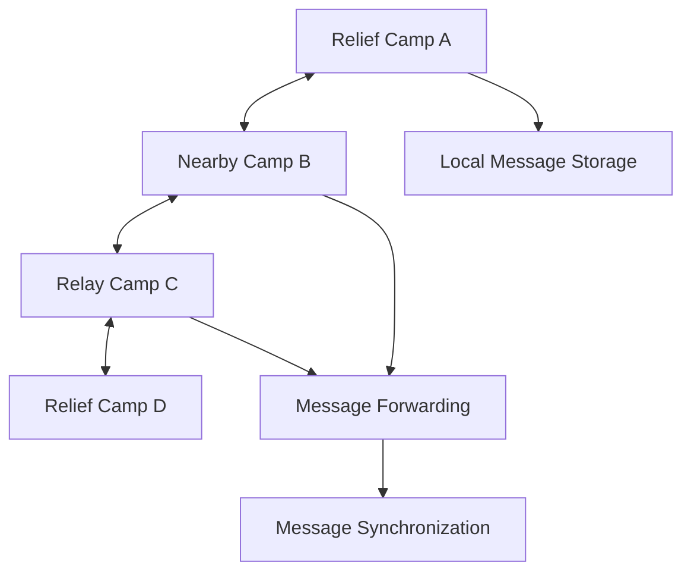
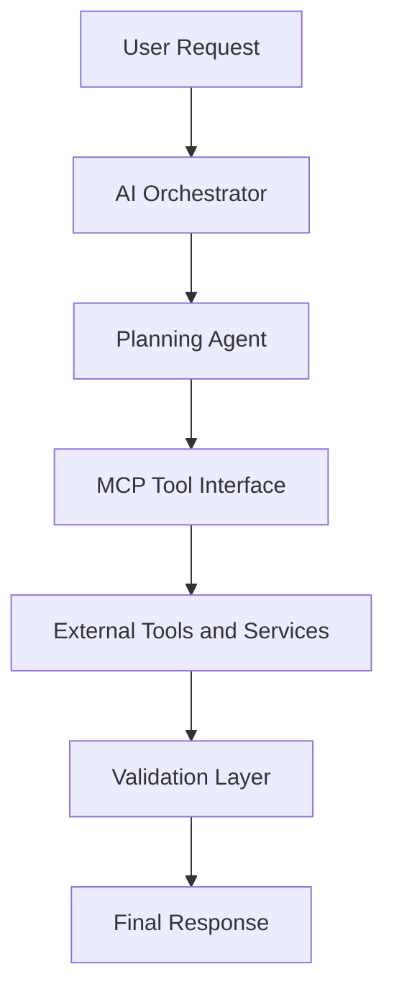

 <!-- README.md -->

<table>
<tr>
<td width="220" align="center" valign="middle">

  
<strong>WAHENGBAM HERAMANI SINGH</strong>
 
@heeraOp
  
Software Developer Cybersecurity Enthusiast AI & Systems Explorer
  
<a href="https://github.com/heeraOp">GitHub</a> · <a href="https://www.linkedin.com/in/wahengbam-heramani-singh-6648263a3">LinkedIn</a>
</td>
<td align="center" valign="middle">

</td>
</tr>
</table>

<h2 align="center">HEERA · ENGINEERING NOTEBOOK</h2>

  <i>Building intelligent systems at the intersection of AI, resilient infrastructure and unconventional computing.</i>

  
  
  

---

## 01 / Technology frontier

Exploring technologies that are changing how software is built, deployed and connected.

| Domain | Technologies and research directions |
|---|---|
| Agentic AI | MCP, autonomous agents, multi-agent orchestration, tool calling |
| Generative AI | Local LLMs, Ollama, RAG, GraphRAG, embeddings |
| AI Infrastructure | Qdrant, vector databases, inference optimization, model evaluation |
| Distributed Systems | Mesh networking, decentralized communication, fault tolerance |
| Edge Computing | Offline-first systems, edge inference, store-and-forward architectures |
| Cybersecurity | Network security, traffic analysis, application security, zero-trust concepts |
| Systems Engineering | Linux, containers, networking, automation, cloud infrastructure |

## 02 / Engineering projects

### PAANGBA — AI-assisted financial access

Consent-based financial access and lender-matching platform.

- Connecting citizens seeking financial assistance with relevant private lenders.
- Exploring document verification, forgery detection and mismatch identification.
- AI-assisted lead matching and eligibility workflows.

`AI-assisted matching` `Document verification` `Financial technology`

### Offline Mesh — Disaster Relief Communication

An offline-first communication concept designed for disaster relief camps.

- Enables nearby relief camps to exchange important information without continuous internet access.
- Explores store-and-forward message propagation.
- Designed around resilient communication during network outages.

`Mesh networking` `Offline-first systems` `Distributed communication`

### HOUSEY — Real-Time Multiplayer Gaming

Real-time online Housie/Tambola platform.

- Multiplayer gameplay with automated number calling.
- Ticket management, prize validation and real-time updates.
- Backend deployed on a Linux VPS.

`Django` `React` `WebSockets` `Redis` `Celery` `PostgreSQL` `Docker`

### Coaching Website — Serverless Content Management

Educational content platform with lightweight cloud-based storage.

- Student-facing resource access.
- Teacher uploads and manages PDFs and images.
- Google Drive and Google Sheets integration.

`React` `Google Apps Script` `Google Drive` `Google Sheets`

### AI-Driven Scheme Matching

Recommendation-engine concept for matching marginalized entrepreneurs with relevant government schemes.

- Eligibility-based scheme discovery.
- AI-assisted recommendations.
- Explicit verification constraints to reduce unsupported recommendations.

`Recommendation systems` `AI` `Eligibility matching`

### Applied LLM & RAG Architecture Exploration

Experimentation with local language models and retrieval-based AI systems.

- Local inference using Ollama.
- Retrieval pipelines and vector embeddings.
- Exploration of Qdrant and grounded generation.

`Ollama` `RAG` `Qdrant` `Embeddings`

---

## 03 / Distributed systems research

### Offline mesh communication architecture

A conceptual store-and-forward communication model for disaster relief environments.

**Research focus:** local discovery, message propagation, synchronization, duplicate handling, delivery acknowledgements and resilience under intermittent connectivity.

### Agentic AI architecture

**Research focus:** tool permissions, agent coordination, context management, execution safety and reliable output validation.

---

## 04 / Technology stack

**Languages**

**Backend and infrastructure**

**AI and intelligent systems**

**Development and operations**

---

## 05 / Current exploration

| Research area | Questions being explored |
|---|---|
| Autonomous software engineering | Can agents independently plan, execute and validate software changes? |
| MCP ecosystems | How can models interact securely with external tools and applications? |
| GraphRAG | How can relationships improve retrieval and reasoning? |
| Local AI inference | How can capable AI systems operate on limited hardware? |
| Decentralized networking | How can communication survive infrastructure failures? |
| Edge AI | How can inference move closer to the source of data? |
| Cybersecurity automation | How can security workflows become more intelligent and verifiable? |

---

## 06 / Connect

<i>Build. Experiment. Break assumptions. Engineer what comes next.</i>

