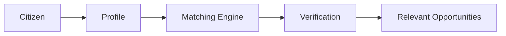
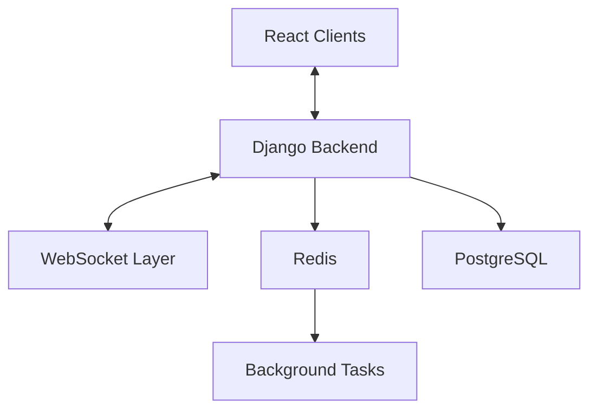
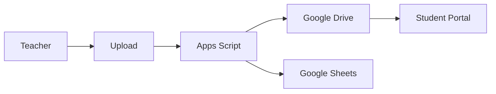
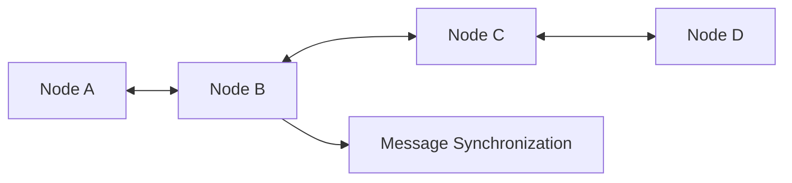
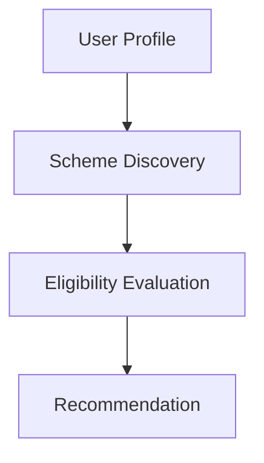
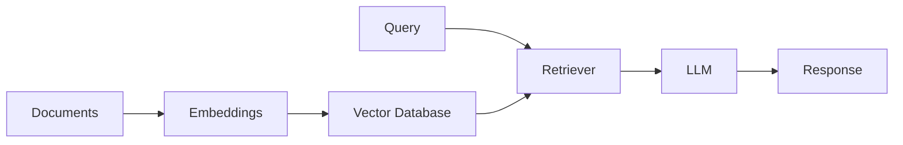

# SYSTEMS / AI / NETWORKS

<p align="center">
  
</p>

<p align="center">
  
  
  
  
</p>

<h1 align="center">ENGINEERING AT THE EDGE OF WHAT'S NEXT.</h1>

<p align="center">
  <strong>Intelligent systems. Autonomous software. Resilient infrastructure.</strong>
</p>

<p align="center">
  Exploring the intersection of emerging technologies, unconventional computing and practical engineering.
</p>

---

## ◈ 01 — SYSTEMS IN THE LAB

<table>
<tr>
<td width="50%" valign="top">

### 01 / APPLIED INTELLIGENCE

- Agentic AI
- Model Context Protocol
- Multi-agent orchestration
- Local LLM inference
- RAG / GraphRAG
- Semantic retrieval

</td>
<td width="50%" valign="top">

### 02 / DISTRIBUTED COMPUTING

- Peer-to-peer systems
- Mesh networking
- Edge computing
- Fault-tolerant systems
- Offline-first architecture
- Decentralized coordination

</td>
</tr>
<tr>
<td width="50%" valign="top">

### 03 / INFRASTRUCTURE

- Linux engineering
- Container orchestration
- Event-driven architecture
- Real-time communication
- Database systems
- Cloud-native deployment

</td>
<td width="50%" valign="top">

### 04 / SECURITY & COMPUTING

- Zero-trust architecture
- Network security
- Defensive engineering
- Autonomous code agents
- Constrained-device inference
- Experimental runtimes

</td>
</tr>
</table>

---

## ◈ 02 — ENGINEERING PROJECTS

<details>
<summary><strong>01. PAANGBA — AI-Assisted Financial Access & Lender Matching</strong></summary>

`APPLIED AI` `DOCUMENT INTELLIGENCE` `RECOMMENDATION SYSTEMS`


</details>

<details>
<summary><strong>02. HOUSEY — Real-Time Multiplayer Gaming Platform</strong></summary>

`DJANGO` `WEBSOCKETS` `REDIS` `POSTGRESQL`


</details>

<details>
<summary><strong>03. COACHING WEBSITE — Serverless Content Management</strong></summary>

`REACT` `GOOGLE DRIVE` `GOOGLE SHEETS`


</details>

<details>
<summary><strong>04. OFFLINE MESH — Disaster Relief Communication</strong></summary>

`DISTRIBUTED NETWORKING` `OFFLINE-FIRST` `STORE-AND-FORWARD`


</details>

<details>
<summary><strong>05. ESIRE — Scheme Intelligence & Eligibility Engine</strong></summary>

`AI` `SCHEME DISCOVERY` `CONSTRAINT REASONING`


</details>

<details>
<summary><strong>06. LLM & RAG — Applied Intelligence Exploration</strong></summary>

`LOCAL INFERENCE` `VECTOR DATABASES` `RETRIEVAL`


</details>

---

## ◈ 03 — THE EMERGING TECHNOLOGY FRONTIER

<p align="center">
  <strong>BEYOND CONVENTIONAL SOFTWARE ENGINEERING</strong>
</p>

| DOMAIN | TECHNOLOGIES & CONCEPTS |
|---|---|
| Agentic intelligence | MCP, autonomous agents, tool orchestration |
| Cognitive computing | GraphRAG, semantic memory, knowledge graphs |
| Local intelligence | Ollama, quantized LLMs, inference optimization |
| Distributed intelligence | P2P, decentralized coordination, edge AI |
| Network evolution | Mesh networking, self-healing networks |
| Autonomous engineering | AI coding agents, evaluation, guardrails |
| Experimental computing | Neuromorphic computing, unconventional architectures |
| Cybersecurity | Zero-trust, Linux hardening, network defense |

<p align="center">
  <sub>Exploration areas and research interests — not claims of completed implementations.</sub>
</p>

---

## ◈ 04 — TECHNOLOGY STACK

**LANGUAGES**

<p>
  
</p>

**FRAMEWORKS & SYSTEMS**

<p>
  
</p>

**INFRASTRUCTURE**

<p>
  
</p>

**AI ECOSYSTEM**

`OLLAMA` · `RAG` · `QDRANT` · `MCP` · `EMBEDDINGS` · `VECTOR SEARCH`

---

## ◈ 05 — GITHUB TELEMETRY

<p align="center">
  
  
</p>

<p align="center">
  
</p>

<p align="center">
  
</p>

---

## ◈ 06 — CURRENT EXPLORATION

```text
[ ACTIVE RESEARCH ]

01  Agentic AI & MCP ecosystems
02  Local LLM deployment and optimization
03  Distributed and offline-first systems
04  Advanced retrieval architectures
05  Linux internals and network engineering
06  AI-assisted autonomous development

[ PRINCIPLE ]

Build → Experiment → Measure → Improve
```

---

<p align="center">
  <strong>ENGINEERED WITH CURIOSITY. BUILT THROUGH EXPERIMENTATION.</strong>
</p>

<p align="center">
  <sub>Systems / Intelligence / Networks / Experimental Computing</sub>
</p>
