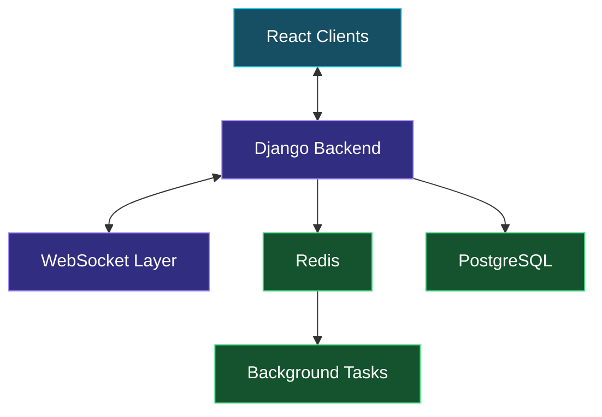
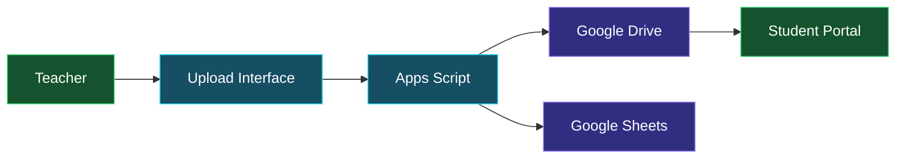
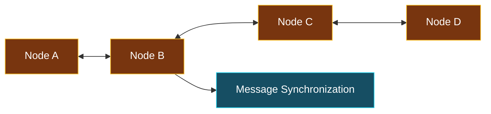
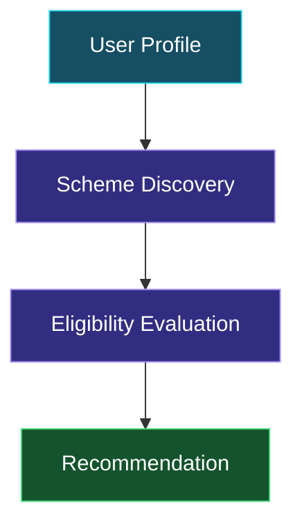
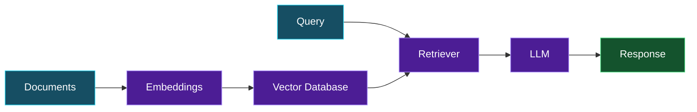

# SYSTEMS / AI / NETWORKS

<p align="center">
  
</p>

<p align="center">
  
  
  
  
</p>

<h1 align="center">ENGINEERING AT THE EDGE OF WHAT'S NEXT.</h1>

<p align="center">
  <strong>Intelligent systems. Autonomous software. Resilient infrastructure.</strong>
</p>

<p align="center">
  Exploring emerging technologies, unconventional computing and practical engineering.
</p>

---

## ◈ 01 — SYSTEMS IN THE LAB

<table>
<tr>
<td width="50%" valign="top">

<h3>🟣 01 / APPLIED INTELLIGENCE</h3>


</td>
<td width="50%" valign="top">

<h3>🔵 02 / DISTRIBUTED COMPUTING</h3>


</td>
</tr>

<tr>
<td width="50%" valign="top">

<h3>🟢 03 / INFRASTRUCTURE</h3>


</td>
<td width="50%" valign="top">

<h3>🔴 04 / SECURITY & COMPUTING</h3>


</td>
</tr>
</table>

---

## ◈ 02 — ENGINEERING PROJECTS

<p align="center">
  
  
  
</p>

<details>
<summary><strong>🟣 01. PAANGBA — AI-Assisted Financial Access & Lender Matching</strong></summary>

`APPLIED AI` `DOCUMENT INTELLIGENCE` `RECOMMENDATION SYSTEMS`


</details>

<details>
<summary><strong>🔵 02. HOUSEY — Real-Time Multiplayer Gaming Platform</strong></summary>

`DJANGO` `WEBSOCKETS` `REDIS` `POSTGRESQL`


</details>

<details>
<summary><strong>🟢 03. COACHING WEBSITE — Serverless Content Management</strong></summary>

`REACT` `GOOGLE DRIVE` `GOOGLE SHEETS`


</details>

<details>
<summary><strong>🟠 04. OFFLINE MESH — Disaster Relief Communication</strong></summary>

`DISTRIBUTED NETWORKING` `OFFLINE-FIRST` `STORE-AND-FORWARD`


</details>

<details>
<summary><strong>🔷 05. ESIRE — Scheme Intelligence & Eligibility Engine</strong></summary>

`AI` `SCHEME DISCOVERY` `CONSTRAINT REASONING`


</details>

<details>
<summary><strong>🟣 06. LLM & RAG — Applied Intelligence Exploration</strong></summary>

`LOCAL INFERENCE` `VECTOR DATABASES` `RETRIEVAL`


</details>

---

## ◈ 03 — THE EMERGING TECHNOLOGY FRONTIER

<p align="center">
  
  
</p>

| DOMAIN | TECHNOLOGIES & CONCEPTS |
|---|---|
| 🟣 Agentic intelligence | MCP, autonomous agents, tool orchestration |
| 🔵 Cognitive computing | GraphRAG, semantic memory, knowledge graphs |
| 🟢 Local intelligence | Ollama, quantized LLMs, inference optimization |
| 🟠 Distributed intelligence | P2P, decentralized coordination, edge AI |
| 🔷 Network evolution | Mesh networking, self-healing networks |
| 🔴 Autonomous engineering | AI coding agents, evaluation, guardrails |
| 🟡 Experimental computing | Neuromorphic computing, unconventional architectures |
| 🟣 Cybersecurity | Zero-trust, Linux hardening, network defense |

<p align="center">
  <sub>Exploration areas and research interests — not claims of completed implementations.</sub>
</p>

---

## ◈ 04 — TECHNOLOGY STACK

### 🟣 LANGUAGES

<p>
  
</p>

### 🔵 FRAMEWORKS & APPLICATION SYSTEMS

<p>
  
</p>

### 🟢 INFRASTRUCTURE & DEVELOPMENT

<p>
  
</p>

### 🟠 AI & INTELLIGENT SYSTEMS

<p>
  
  
  
  
  
  
</p>

---

## ◈ 05 — GITHUB TELEMETRY

<p align="center">
  
  
</p>

<p align="center">
  
  
</p>

<p align="center">
  
</p>

<p align="center">
  
</p>

<p align="center">
  <sub>Live statistics depend on third-party services and public GitHub activity.</sub>
</p>

---

## ◈ 06 — CURRENT EXPLORATION

<p align="center">
  
</p>

```text
┌──────────────────────────────────────────┐
│             RESEARCH QUEUE               │
├──────────────────────────────────────────┤
│                                          │
│  01  Agentic AI & MCP ecosystems         │
│  02  Local LLM deployment & optimization │
│  03  Distributed & offline-first systems │
│  04  Advanced retrieval architectures    │
│  05  Linux internals & network engineering│
│  06  AI-assisted autonomous development │
│                                          │
├──────────────────────────────────────────┤
│                                          │
│  BUILD → EXPERIMENT → MEASURE → IMPROVE  │
│                                          │
└──────────────────────────────────────────┘
```

---

<p align="center">
  
  
</p>

<h3 align="center">ENGINEERED WITH CURIOSITY. BUILT THROUGH EXPERIMENTATION.</h3>

<p align="center">
  <sub>SYSTEMS / INTELLIGENCE / NETWORKS / EXPERIMENTAL COMPUTING</sub>
</p>
