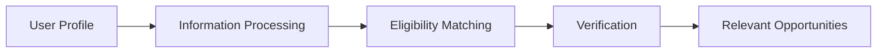
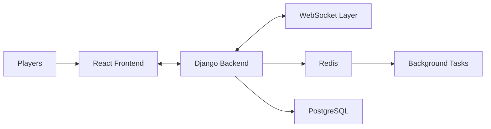
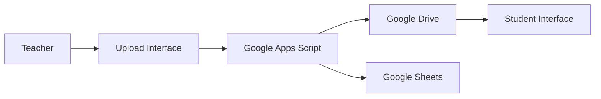
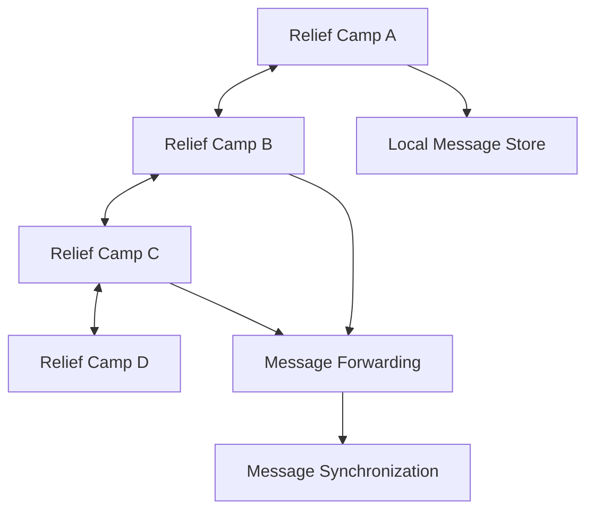
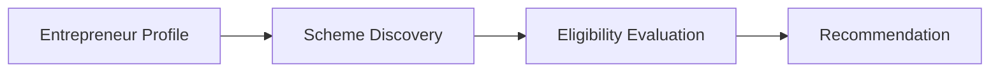
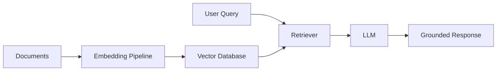

# SYSTEMS / AI / NETWORKS

  

<h1 align="center">WAHENGBAM HERAMANI SINGH</h1>

  

  <strong>@heeraOp</strong>
   
  B.Tech CSE Student · Software Developer · AI & Systems Explorer

  <a href="https://github.com/heeraOp">GitHub</a> ·
  <a href="https://www.linkedin.com/in/wahengbam-heeramani-singh-6648263a3">LinkedIn</a> ·
  <a href="https://heeraop.github.io/heera-portfolio/">Portfolio</a>

---

<h2 align="center">HEERA · ENGINEERING NOTEBOOK</h2>

  <em>Building intelligent systems at the intersection of AI, resilient infrastructure and unconventional computing.</em>

  
  
  

---

## 01 / TECHNOLOGY ECOSYSTEM

| SYSTEMS | INTELLIGENCE | INFRASTRUCTURE |
|---|---|---|
| Distributed systems | Agentic AI | Linux |
| Mesh networking | MCP | Docker |
| P2P communication | Local LLMs | Nginx |
| Edge computing | RAG / GraphRAG | PostgreSQL |
| Offline-first systems | Multi-agent systems | Redis |
| Network engineering | Vector databases | Cloud infrastructure |

## 02 / ENGINEERING PROJECTS

### **01 — PAANGBA**
`AI` `FINTECH` `DOCUMENT INTELLIGENCE`

### **02 — HOUSEY**
`REAL-TIME SYSTEMS` `WEBSOCKETS` `DISTRIBUTED APPLICATIONS`

### **03 — COACHING WEBSITE**
`SERVERLESS` `CONTENT MANAGEMENT` `CLOUD STORAGE`

### **04 — OFFLINE MESH COMMUNICATION**
`MESH NETWORKING` `DISASTER RESPONSE` `OFFLINE-FIRST`

### **05 — AI-DRIVEN SCHEME MATCHING**
`RECOMMENDATION SYSTEMS` `AI` `ELIGIBILITY`

### **06 — APPLIED LLM & RAG EXPLORATION**
`LOCAL INFERENCE` `RAG` `VECTOR SEARCH`

---

## 03 / EMERGING TECHNOLOGY FRONTIER

| RESEARCH AREA | EXPLORATION |
|---|---|
| Agentic AI | MCP, autonomous agents, tool calling |
| Local intelligence | Ollama, local inference, RAG |
| Advanced retrieval | GraphRAG, embeddings, semantic search |
| Distributed computing | P2P, decentralization, fault tolerance |
| Edge intelligence | Edge AI, constrained inference |
| Resilient networking | Mesh, offline-first, store-and-forward |
| Cybersecurity | Zero-trust, Linux security, network defense |
| Autonomous engineering | AI orchestration, code agents, evaluation |

*These are exploration areas, not claims of completed implementations.*

---

## 04 / TECHNICAL STACK

**LANGUAGES**

  

**FRAMEWORKS & BACKEND**

  

**INFRASTRUCTURE & DEVELOPMENT**

  

**AI & INTELLIGENT SYSTEMS**

`OLLAMA` · `RAG` · `QDRANT` · `MCP` · `EMBEDDINGS` · `LOCAL LLMS`

---

## 05 / GITHUB CONTRIBUTION & ACTIVITY

  
  

  

  

Statistics and contribution visualizations are supplied by external services and may occasionally be unavailable.

---

## 06 / CONNECT

  
  
  

  BUILD · EXPERIMENT · EXPLORE · ENGINEER

